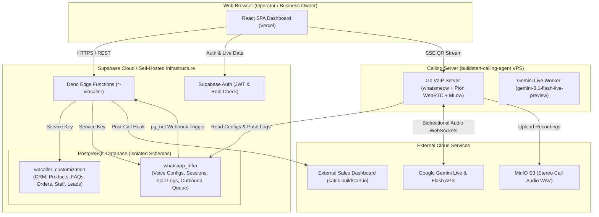
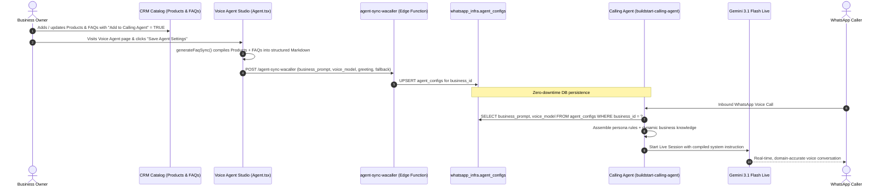
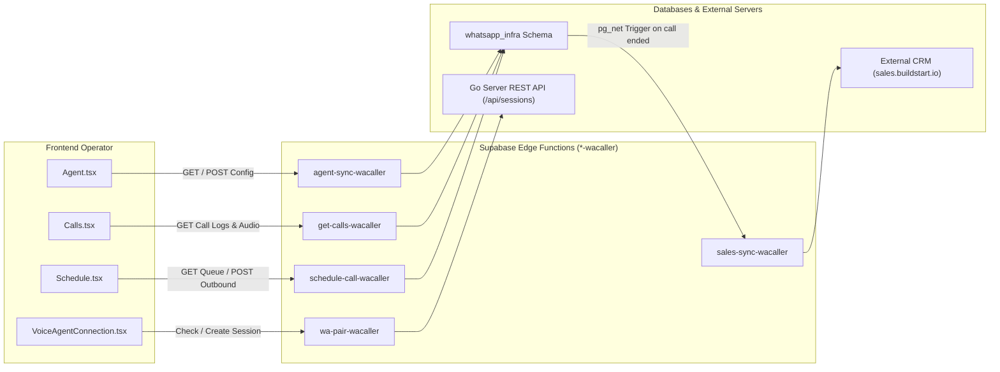
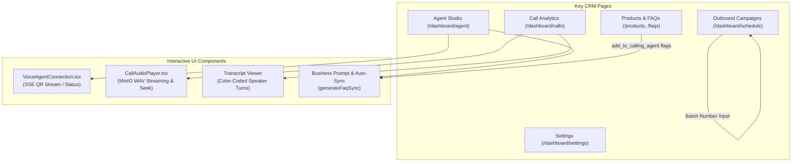
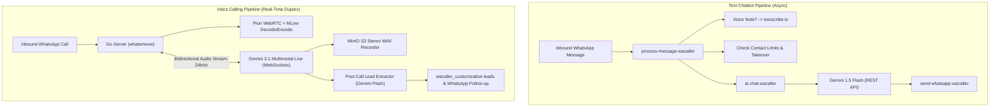
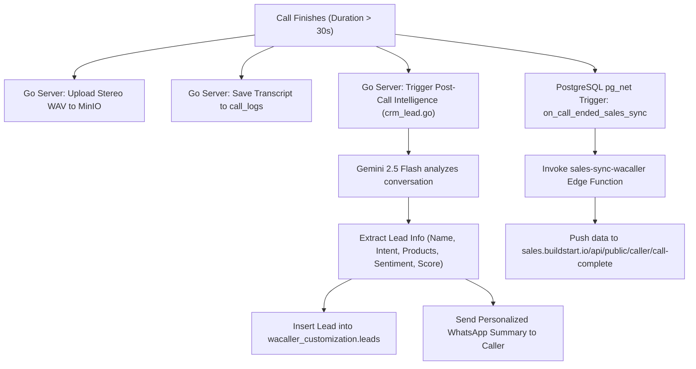
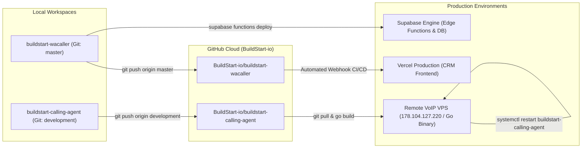

# BuildStart WACaller CRM & Calling Agent Architecture

Welcome to the comprehensive architecture guide for **BuildStart WACaller**. This document explains the internal design, component relationships, data pipelines, and intelligence flows powering the BuildStart CRM and its real-time AI Voice Calling Agent integration.

---

## 1. Executive Summary & System Purpose

**BuildStart WACaller** is an enterprise-grade WhatsApp Customer Relationship Management (CRM) and conversational commerce platform. It transforms standard WhatsApp business accounts into an automated, AI-driven sales and support operation with two synchronized "brains":

1. **Text AI Agent (Chatbot)**: Handles asynchronous customer messaging, product catalogs, order taking, media sharing, and automated welcome/follow-up sequences.
2. **Voice AI Agent (Calling Agent)**: Handles real-time, low-latency, two-way conversational phone calls directly over WhatsApp using Google's Gemini Multimodal Live API and WebRTC/MLow audio.

The primary superpower of BuildStart WACaller is **Unified Knowledge & Closed-Loop Operations**:
A business owner manages their products, FAQs, pricing, and business rules in the CRM. The platform automatically compiles this data into conversational knowledge, pushes it to the voice calling server, records and transcribes calls, extracts customer intent into CRM leads, and triggers post-call WhatsApp summaries—all without manual intervention.



---

## 2. Multi-Repository & Multi-Tenant Infrastructure

The platform is designed around strict separation of concerns across independent code repositories and isolated database schemas:

| Repository / Component | Technology Stack | Deployment Host | Primary Responsibility |
| :--- | :--- | :--- | :--- |
| **`buildstart-wacaller` (Frontend)** | React 18, Vite, TypeScript, TailwindCSS, TanStack Query, Radix UI | Vercel (Automated CI/CD on git push to `master`) | Web CRM dashboard, analytics, product catalog, FAQ editor, calling studio, call log player. |
| **`buildstart-wacaller` (Edge Functions)** | Deno, TypeScript, Supabase JS Client v2 | Supabase Functions Engine | Secure API gateway, multi-tenant staff resolution, knowledge synchronization, outbound call scheduling. |
| **`buildstart-calling-agent` (Go Server)** | Native Go 1.24, Pion WebRTC, whatsmeow, google-genai SDK, MLow | Dedicated Production VPS (`178.104.127.220`), systemd service | WhatsApp protocol connection, RTP audio streaming, Gemini Multimodal Live duplex session, call audio recording. |

### Shared PostgreSQL Isolation (Critical Safety Model)
The PostgreSQL database runs in a multi-tenant environment shared with other client applications. To prevent collisions and ensure zero blast radius:
- **`wacaller_customization`**: Houses all CRM business tables (`products`, `faqs`, `orders`, `conversations`, `messages`, `staff_accounts`, `leads`, `business_settings`).
- **`whatsapp_infra`**: Houses all voice infrastructure tables (`agent_configs`, `whatsapp_sessions`, `call_logs`, `scheduled_calls`, `whatsmeow_lid_map`).
- **Strict Isolation Rule**: Frontend applications never connect directly to `whatsapp_infra`. All operations touching `whatsapp_infra` are brokered through dedicated Supabase Edge Functions with the suffix `-wacaller` using the secure `SUPABASE_SERVICE_ROLE_KEY`.

---

## 3. How Business Knowledge is Built, Compiled & Synchronized

One of the most sophisticated parts of BuildStart WACaller is how it takes regular business data and turns it into real-time speech context for the calling agent.



### Step 1: Source Data Entry with Selective Ingestion
In the CRM, every Product (`Products.tsx`) and FAQ item (`Faqs.tsx`) has a toggle switch: **"Add to Calling Agent"** (`add_to_calling_agent: boolean`).
- **Default value**: `true`
- **Purpose**: A business might offer 200 items in their full web store or lengthy technical text documents, but only want 15 fast-selling products and top 10 urgent delivery questions available to the phone agent to keep the voice conversation sharp, fast, and concise.

### Step 2: In-Browser Knowledge Compilation Engine
When the owner opens the Voice Agent Studio (`frontend/src/pages/Agent.tsx`), the frontend pulls:
1. Active products (`is_active = true`) where `add_to_calling_agent != false`.
2. Active FAQs (`is_active = true`) where `add_to_calling_agent != false`.

The compilation function `generateFaqSync()` transforms relational SQL rows into human-and-AI-friendly structured Markdown:

```typescript
const generateFaqSync = (currentPrompt: string) => {
  let knowledge = "\n\n--- BUSINESS KNOWLEDGE (AUTO-GENERATED) ---\n";
  
  // 1. Compile Product Catalog
  if (products && products.length > 0) {
    knowledge += "[Products & Services]\n";
    products.forEach((p: any) => {
      knowledge += `- ${p.name}: LKR ${p.price}`;
      if (p.product_type) knowledge += ` (Type: ${p.product_type})`;
      if (p.description) knowledge += ` - ${p.description}`;
      knowledge += "\n";
    });
    knowledge += "\n";
  }

  // 2. Compile FAQs
  if (faqs && faqs.length > 0) {
    knowledge += "[Frequently Asked Questions]\n";
    faqs.forEach((f: any) => {
      knowledge += `- Q: ${f.question} | A: ${f.answer}\n`;
    });
    knowledge += "\n";
  }
  knowledge += "-------------------------------------------\n";

  // 3. Delimiter Replacement: Preserves custom user instructions
  const delimiterRegex = /--- BUSINESS KNOWLEDGE \(AUTO-GENERATED\) ---[\s\S]*?-------------------------------------------/;
  if (delimiterRegex.test(currentPrompt)) {
    return currentPrompt.replace(delimiterRegex, knowledge.trim());
  } else {
    return currentPrompt.trim() + knowledge;
  }
};
```

#### Why Delimiter Merging Matters:
The business owner might write custom personality guidelines, tone instructions, or special discounts at the top of the prompt:
> *"You are Sarah, a warm, polite concierge for Colombo Flower Boutique. Always greet callers with Ayubowan. If they ask about weekend deliveries, offer a 10% discount."*

The knowledge compiler uses regex delimiters so that editing products or re-generating the knowledge base **never overwrites** the owner's custom persona rules. It cleanly swaps only the auto-generated section.

### Step 3: Secure Edge Synchronization (`agent-sync-wacaller`)
When the owner clicks **"Save Agent Settings"**, the frontend sends a signed HTTP POST request with their Supabase Bearer token:
```json
{
  "business_prompt": "You are Sarah...\n--- BUSINESS KNOWLEDGE (AUTO-GENERATED) ---...",
  "voice_model": "Puck",
  "greeting_message": "Hello! Thank you for calling Colombo Flower Boutique. How can I help you today?",
  "fallback_message": "I apologize, could you please repeat that?"
}
```

The edge function (`supabase/functions/agent-sync-wacaller/index.ts`):
1. Verifies the user's JWT with Supabase Auth.
2. Resolves multi-tenant ownership: Checks if the user is a staff member in `wacaller_customization.staff_accounts`. If yes, it retrieves the `owner_id`; otherwise it uses `user.id`.
3. Connects to the private `whatsapp_infra` schema using `SUPABASE_SERVICE_ROLE_KEY`.
4. Executes an `UPSERT` on `whatsapp_infra.agent_configs`:
   ```sql
   INSERT INTO whatsapp_infra.agent_configs (
     business_id, business_prompt, greeting_message, fallback_message, voice_model, updated_at
   ) VALUES (
     $1, $2, $3, $4, $5, NOW()
   )
   ON CONFLICT (business_id) DO UPDATE SET
     business_prompt = EXCLUDED.business_prompt,
     greeting_message = EXCLUDED.greeting_message,
     fallback_message = EXCLUDED.fallback_message,
     voice_model = EXCLUDED.voice_model,
     updated_at = NOW();
   ```

### Step 4: Voice Runtime Prompt Injection
When an incoming or outbound call starts on the Go server (`buildstart-calling-agent`):
1. The server loads the row from `whatsapp_infra.agent_configs` for that `business_id`.
2. It prepends conversational voice constraints (natural interjections, avoiding long lists, asking clarifying questions, conversational turn handling).
3. It passes the complete string into the Gemini Multimodal Live API `LiveConnectConfig` under `SystemInstruction`.
4. Because the prompt is injected dynamically at call setup time, any update in the CRM is immediately active on the very next phone call without restarting the Go server or redeploying any container.

---

## 4. Deep Dive: Edge Functions Architecture

All serverless backend operations for `buildstart-wacaller` reside in `supabase/functions/` and are strictly named with the `-wacaller` suffix. Below is a detailed analysis of every calling-agent-related edge function:



### 1. `agent-sync-wacaller` (`supabase/functions/agent-sync-wacaller/index.ts`)
- **Method**: `GET` / `POST`
- **Role**: The configuration bridge between the CRM frontend and the voice agent engine.
- **Key Logic**:
  - `GET`: Authenticates user, resolves `business_id` (supporting staff tenancy), and returns existing voice settings from `whatsapp_infra.agent_configs`.
  - `POST`: Validates inputs and performs an upsert into `whatsapp_infra.agent_configs` (`business_prompt`, `greeting_message`, `fallback_message`, `voice_model`).
  - **Security**: Validates bearer JWT against `supabase.auth.getUser(token)`; enforces that staff only read and write to their assigned owner's configuration.

### 2. `get-calls-wacaller` (`supabase/functions/get-calls-wacaller/index.ts`)
- **Method**: `GET`
- **Role**: Provides the audit log and audio metadata for all phone calls handled by the AI.
- **Key Logic**:
  - Queries `whatsapp_infra.call_logs` filtered by `business_id = businessId`.
  - Orders by `started_at DESC` (limiting to the 100 most recent calls).
  - Sanitizes and formats:
    - Calculates `duration` in seconds if missing using `ended_at - started_at`.
    - Parses `transcript_json` (converts strings or JSON arrays to uniform `{ role, message, timestamp }` turns).
    - Returns caller numbers, call directions (`inbound` vs `outbound`), status (`ended`, `ringing`, `in_progress`), and audio recording availability.

### 3. `schedule-call-wacaller` (`supabase/functions/schedule-call-wacaller/index.ts`)
- **Method**: `GET` / `POST`
- **Role**: Manages outbound calling campaigns and single test calls.
- **Key Logic**:
  - `GET`: Returns active queued or pending calls from `whatsapp_infra.scheduled_calls` for this business.
  - `POST`:
    - Accepts an array of phone numbers (`numbers: string[]`) and a gap interval in minutes (`gapMinutes: number`).
    - Cleans phone numbers (strips spaces, dashes, leading `+` or `0`, standardizes international E.164 formats).
    - Iterates through the list, calculating incremental scheduled timestamps:
      $$\text{scheduled\_time}_i = \text{now} + (i \times \text{gapMinutes})$$
    - Bulk inserts the records into `whatsapp_infra.scheduled_calls` with status `'pending'`.
    - **Go Worker Execution**: The Go server runs a background cron worker that queries `whatsapp_infra.scheduled_calls` where `scheduled_time <= NOW()` and `status = 'pending'`, locks the row using `FOR UPDATE SKIP LOCKED`, and initiates the outbound call.

### 4. `wa-pair-wacaller` (`supabase/functions/wa-pair-wacaller/index.ts`)
- **Method**: `POST`
- **Role**: Coordinates WhatsApp device pairing between the CRM and the Go VoIP server.
- **Key Logic**:
  - Resolves `business_id`.
  - Calls the Go server endpoint `GET ${GO_SERVER_URL}/api/sessions`.
  - If a session already exists for the business, returns the existing session ID and state (e.g. `open`, `qr`, `connecting`).
  - If no session exists, issues `POST ${GO_SERVER_URL}/api/sessions` with `{ business_id: businessId }`, initializing a new whatsmeow client instance and returning the `session_id`.

### 5. `sales-sync-wacaller` (`supabase/functions/sales-sync-wacaller/index.ts`)
- **Method**: `POST` (Triggered via PostgreSQL `pg_net` webhook)
- **Role**: Real-time sales integration webhook.
- **Trigger**: Fired by PostgreSQL trigger `on_call_ended_sales_sync` on `whatsapp_infra.call_logs` whenever a call status transitions to `'ended'` and `duration > 30` seconds.
- **Key Logic**:
  - Receives the updated call record from PostgreSQL.
  - Formats payload:
    ```json
    {
      "phone": "94769652770",
      "call_status": "answered",
      "call_duration_seconds": 142,
      "send_whatsapp": true
    }
    ```
  - Posts with `CALLER_API_KEY` authorization to `https://sales.buildstart.io/api/public/caller/call-complete`, synchronizing telephony outcomes into the core sales pipeline.

---

## 5. Frontend Operator Architecture

The `frontend/` directory is built with modern React 18, Vite, and Tailwind CSS. The operator interface gives business owners complete control over the voice agent without needing any technical knowledge.



### 1. Voice Agent Studio (`frontend/src/pages/Agent.tsx`)
The nerve center for configuring the calling AI:
- **Voice Model Picker**: Allows selecting from Google's high-fidelity Gemini voices:
  - *Puck* (Playful, energetic)
  - *Charon* (Deep, authoritative)
  - *Aoede* (Warm, melodic)
  - *Fenrir* (Strong, steady)
  - *Kore*, *Leda*, *Orus*, *Zephyr*
- **Greeting & Fallback Customizer**: The immediate greeting spoken when the user picks up, plus the polite fallback phrase spoken during unexpected audio hiccups or confusion.
- **Knowledge Synchronization Bar**: Displays how many products and FAQs are active and flagged for voice. A single click compiles and syncs them.
- **Test Call Drawer**: Lets the owner enter their personal phone number to receive an immediate test phone call from the agent.

### 2. Live Call Audit & Player (`frontend/src/pages/Calls.tsx`)
Provides full transparency into AI-customer conversations:
- **Summary Metrics**: High-level KPI cards displaying Total Calls, Answered Calls, and Cumulative Duration.
- **Call Table**: Lists every inbound and outbound interaction with duration, status badges, and timestamp.
- **Stereo Audio Player (`CallAudioPlayer.tsx`)**:
  - Connects to MinIO Object Storage (`https://storage.buildstart.io/call-recordings/<business_id>/<call_id>.wav`).
  - Supports streaming, play/pause, scrub bar, volume control, and direct WAV download.
- **Full Transcript Inspector**:
  - Opens a dialog displaying the entire dialog turn by turn.
  - Distinguishes between **Caller** (customer) and **AI Consultant** with clean color-coded badges and timestamps.

### 3. Outbound Voice Campaigns (`frontend/src/pages/Schedule.tsx`)
Allows businesses to automate sales and reminder calls:
- **Bulk Number Ingestion**: Paste hundreds of numbers separated by newlines or commas.
- **Configurable Cadence**: Sets `gapMinutes` (e.g., 1 minute between calls) to prevent overwhelming the WhatsApp account or simultaneous bandwidth limits.
- **Live Queue Monitor**: Polls `schedule-call-wacaller` every 5 seconds to display calls in state `pending`, `calling`, `completed`, or `failed`.
- **Single Test Trigger**: Rapid test call facility with `gapMinutes = 0`.

### 4. WhatsApp Multi-Device Pairing (`VoiceAgentConnection.tsx`)
Enables direct pairing of the voice calling WhatsApp number:
- Establishes a Server-Sent Events (SSE) connection directly to the Go server:
  ```javascript
  const eventSource = new EventSource(`${goServerUrl}/api/events?session_id=${sessionId}`);
  ```
- Renders animated QR codes in real time as WhatsApp cycles pairing keys.
- Automatically transitions from `qr` to `open` upon scanning, updating the CRM status badge to **"Connected"**.

---

## 6. Dual-Brain Comparison: Text Bot vs. Voice Calling Agent

BuildStart WACaller runs two completely different conversational AI pipelines side by side. Understanding their differences is crucial:



| Feature / Dimension | Text Chatbot (`ai-chat-wacaller`) | Voice Calling Agent (`buildstart-calling-agent`) |
| :--- | :--- | :--- |
| **Model** | `gemini-1.5-flash` / `gemini-2.0-flash` (REST request/response) | `gemini-3.1-flash-live-preview` (Bi-directional WebSocket) |
| **Protocol** | WhatsApp text & media messages via Cloud API / wsender | Native VoIP signalling, Pion WebRTC, MLow audio codec |
| **Turn Latency** | 1.5 – 3.0 seconds | **300 – 600 milliseconds** (real-time voice interruption) |
| **Audio Processing** | Transcribes inbound voice notes to text; replies with text | Streams raw 16-bit 24kHz/16kHz PCM audio bidirectionally |
| **Knowledge Assembly** | Injected per message in `ai-chat-wacaller` | Injected at call setup in `whatsapp_infra.agent_configs` |
| **Recording & Audit** | Stored in `wacaller_customization.messages` | Stereo WAV in MinIO S3 + `call_logs` transcript |
| **Follow-up Action** | Interactive buttons, catalog cards, order links | Post-call lead qualification dossier + automated WhatsApp summary |

---

## 7. Post-Call Closed-Loop Intelligence

When a voice conversation ends, the system does not simply hang up. It triggers an automated post-call intelligence pipeline:



1. **Dual-Channel Audio Archiving**: The Go server records both sides of the conversation (Caller on Channel 0, AI on Channel 1) and uploads a standard 16-bit stereo `.wav` file to MinIO S3 (`call-recordings/<business_id>/<call_id>.wav`).
2. **Transcript Persistence**: Every speaker turn is recorded with millisecond timestamps and stored in `whatsapp_infra.call_logs.transcript_json`.
3. **Autonomous Lead Qualification (`crm_lead.go`)**:
   If the call contains $\ge 2$ conversational turns, the Go server dispatches the transcript to `gemini-2.5-flash` with a structured extraction schema:
   - **Customer Name & Details**
   - **Expressed Interest & Mentioned Products**
   - **Customer Sentiment** (Positive, Neutral, Hesitant, Frustrated)
   - **Lead Qualification Score** (1 to 10)
   - **Next Action Items**
4. **Automated WhatsApp Follow-Up**:
   The AI writes a friendly WhatsApp message summarizing what was discussed (e.g., confirming the flower arrangement discussed, delivery timing, and payment instructions) and sends it immediately to the caller's WhatsApp chat.
5. **Third-Party Sales Webhook**:
   The database trigger `on_call_ended_sales_sync` informs external systems (`sales.buildstart.io`) that a verified voice conversation completed.

---

## 8. Multi-Tenancy, Roles & Staff Access Control

BuildStart WACaller supports team collaboration where business owners can invite staff members to assist in operating the CRM without granting them administrative access or access to other tenants:

### Staff Tenancy Resolution Pattern
In every edge function (such as `agent-sync-wacaller` or `get-calls-wacaller`), the tenant identity is resolved dynamically:

```typescript
// 1. Check if the authenticated user is a staff account
const { data: staffData } = await supabaseWacaller
  .from('staff_accounts')
  .select('owner_id')
  .eq('staff_user_id', user.id)
  .eq('is_active', true)
  .maybeSingle();

// 2. Resolve the true business tenant ID
const businessId = staffData?.owner_id || user.id;
```

### Permission Matrix

| Role | Dashboard & Analytics | Chats & Messaging | Voice Agent Config (`Agent.tsx`) | Call Logs (`Calls.tsx`) | Outbound Campaigns (`Schedule.tsx`) | Products & FAQs | Settings & Billing |
| :--- | :---: | :---: | :---: | :---: | :---: | :---: | :---: |
| **Business Owner** | Full Access | Full Access | Full Access | Full Access | Full Access | Full Access | Full Access |
| **Staff (Conversations)** | View | Full Access | Hidden / Read-only | Full Access | Full Access | View | Hidden |
| **Staff (Products/Catalog)**| View | Hidden | Hidden | Hidden | Hidden | Full Access | Hidden |
| **Staff (Settings)** | View | View | Full Access | Full Access | View | Full Access | Full Access |
| **Super Admin** | Platform-wide | Platform-wide | Platform-wide | Platform-wide | Platform-wide | Platform-wide | Platform-wide |

---

## 9. Deployment Architecture & CI/CD Pipelines



### 1. Frontend CRM Deployment (Vercel)
- **Branch**: `master` on `BuildStart-io/buildstart-wacaller`
- **Build Command**: `npm run build`
- **Output Directory**: `dist`
- **Automation**: Any commit pushed to `origin/master` immediately triggers an automated preview and production deployment on Vercel.

### 2. Supabase Edge Functions Deployment
- Deploy individual edge functions using the Supabase CLI:
  ```bash
  supabase functions deploy agent-sync-wacaller --project-ref <PROJECT_ID>
  supabase functions deploy get-calls-wacaller --project-ref <PROJECT_ID>
  supabase functions deploy schedule-call-wacaller --project-ref <PROJECT_ID>
  supabase functions deploy wa-pair-wacaller --project-ref <PROJECT_ID>
  supabase functions deploy sales-sync-wacaller --project-ref <PROJECT_ID>
  ```
- **Rule**: Every function belonging to this platform must have the `-wacaller` suffix.

### 3. Voice Server Deployment (Go VPS)
- **Host**: `178.104.127.220` (path: `/opt/buildstart-calling-agent`)
- **Service Manager**: `systemd` (`buildstart-calling-agent.service`)
- **Deployment Steps**:
  1. Commit and push Go code to `BuildStart-io/buildstart-calling-agent` (`development` branch).
  2. SSH to production server: `ssh root@178.104.127.220`.
  3. Pull changes: `cd /opt/buildstart-calling-agent && git pull origin development`.
  4. Compile binary: `go build -o buildstart-calling-agent main.go`.
  5. Restart service: `systemctl restart buildstart-calling-agent.service`.

---

## 10. Summary: The Architectural Guarantee

The architecture of **BuildStart WACaller** guarantees:
1. **Zero Database Conflicts**: Strict separation of `wacaller_customization` and `whatsapp_infra` prevents CRM schema changes from ever interrupting real-time VoIP sessions.
2. **Instant Knowledge Propagation**: Edits made to products, prices, and FAQs in the CRM dashboard are dynamically compiled and live on telephone calls within seconds.
3. **Operator Simplicity**: Complex MLow WebRTC audio, WebSocket streaming, and Gemini Multimodal Live mechanics are completely abstracted behind simple toggles, prompts, and audio players.
4. **Complete Traceability**: Every second of audio, every word transcribed, and every lead generated is linked, indexed, and actionable directly within the CRM.

